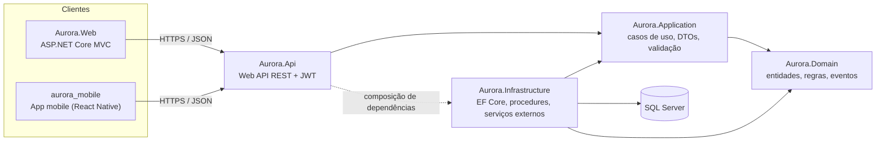
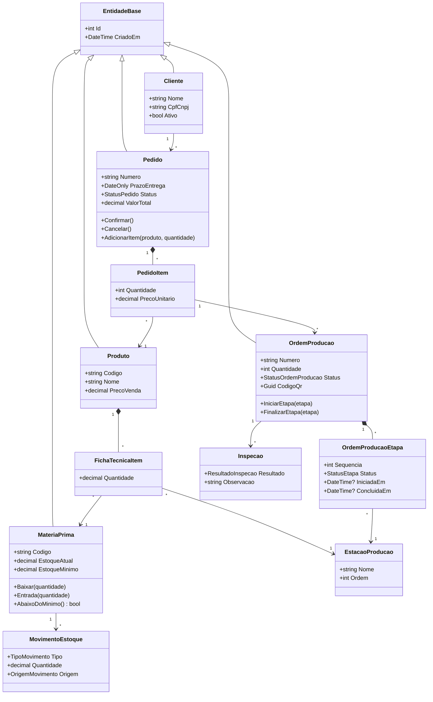

# 04 - Arquitetura de Software (Etapa 6)

**Disciplina:** Programação Aplicada em .NET
**Relacionados:** `00-escopo.md`, `05-banco-de-dados.md`, `06-api-rest.md`

> Este documento é a **especificação** para implementar o sistema (no Claude Code ou à mão).
> Também é a base do texto da Etapa 6 do PIM: orientação a objetos, camadas, modularização,
> padrões de projeto e estratégias de manutenção e evolução.

---

## 1. Decisões técnicas

Registre aqui qualquer mudança de decisão (data, motivo). Itens ⚠️ ainda dependem de
confirmação com os professores.

| # | Decisão | Escolha | Motivo | Alternativa |
|---|---|---|---|---|
| D01 | ⚠️ Plataforma | **.NET LTS atual** (10; usar 8 se a disciplina usar) | Suporte de longo prazo | .NET 8 |
| D02 | Estilo arquitetural | **Arquitetura em camadas** (Domain, Application, Infrastructure, apresentação) | Separação de responsabilidades; testável | Monólito sem camadas |
| D03 | API | **ASP.NET Core Web API (REST)** com JWT | Contrato único para web e mobile | gRPC |
| D04 | Web | **ASP.NET Core MVC (Razor)** consumindo a API | Integração real entre módulos; didático | Blazor |
| D05 | Mobile | ✅ React Native (Expo + TypeScript); Android primeiro | Autorizado pelo professor em 30/10/2026; o grupo já domina (`08-mobile.md` §1.1) | Flutter, .NET MAUI |
| D06 | Acesso a dados | **EF Core** para CRUD + **procedures** para regras críticas | Atomicidade do estoque no banco | Somente EF Core |
| D07 | Banco | **SQL Server** (confirmado; Azure SQL na nuvem) | Procedures, triggers e T-SQL | PostgreSQL/MariaDB |
| D08 | Versionamento do banco | Scripts SQL numerados + **DbUp** | Banco como fonte da verdade | EF Migrations |
| D09 | Validação | **FluentValidation** | Regras fora dos controllers | DataAnnotations |
| D10 | Testes | **xUnit** + Moq + Testcontainers | Padrão do ecossistema | NUnit |
| D11 | Nomes | Domínio em **português** (Pedido, OrdemProducao); sufixos técnicos em inglês (Service, Repository, Controller) | Coerência com banco e documentos | Tudo em inglês |
| D12 | Nuvem | ⚠️ **Azure** | Integração com .NET | AWS |

---

## 2. Visão geral



**Regra de dependência:** as setas apontam para quem é conhecido. `Domain` não conhece
ninguém. `Application` conhece só `Domain`. `Infrastructure` implementa as interfaces
definidas em `Application`. `Api` monta tudo (injeção de dependência).

---

## 3. Estrutura da solução

```
Pim_Final/
├─ docs/                          documentação (este conjunto)
├─ database/
│  ├─ 001-schema.sql              tabelas, constraints, índices
│  ├─ 002-views.sql
│  ├─ 003-procedures.sql
│  ├─ 004-triggers.sql
│  ├─ 005-seguranca.sql           logins, usuários, permissões
│  └─ 006-seed.sql                dados iniciais (sem senhas)
├─ src/
│  ├─ Aurora.Domain/              Entidades, Enums, Eventos, Exceções de domínio
│  ├─ Aurora.Application/         Casos de uso (Services), DTOs, Validators, Interfaces
│  ├─ Aurora.Infrastructure/      DbContext, Repositórios, Chamadas de procedures, JWT, QR, relatórios
│  ├─ Aurora.Api/                 Controllers, Middlewares, Program.cs, Swagger
│  └─ Aurora.Web/                 Controllers MVC, Views, wwwroot, clientes tipados da API
├─ mobile/
│  └─ aurora_mobile/              App mobile React Native (ver 08-mobile.md); fora da solução .NET
├─ tests/
│  ├─ Aurora.Domain.Tests/
│  ├─ Aurora.Application.Tests/
│  └─ Aurora.Api.IntegrationTests/
├─ infra/                         Bicep (IaC)
├─ docker/                        Dockerfiles e docker-compose
├─ .github/workflows/             CI/CD
├─ Directory.Build.props          versão do .NET, analisadores, nullable
├─ .editorconfig
└─ Aurora.sln
```

**Dependências entre projetos:**

| Projeto | Referencia |
|---|---|
| Domain | (nenhum) |
| Application | Domain |
| Infrastructure | Application, Domain |
| Api | Application, Infrastructure |
| Web | (nenhum projeto .NET; consome a API por HTTP, com um pequeno pacote de contratos opcional) |
| Mobile | Não faz parte da solução .NET; consome a API por HTTP |

---

## 4. Camadas e responsabilidades

| Camada | Contém | Não contém |
|---|---|---|
| **Domain** | Entidades com comportamento, enums de status, eventos de domínio, exceções de regra | Acesso a banco, HTTP, frameworks |
| **Application** | Casos de uso (um serviço por módulo), DTOs, validadores, interfaces de repositório e serviços | Detalhes de EF Core e SQL |
| **Infrastructure** | `AuroraDbContext`, repositórios, execução das procedures, emissão de JWT, geração de QR code, exportação PDF/Excel | Regras de negócio |
| **Api** | Controllers finos, autenticação/autorização, tratamento global de erros, Swagger | Lógica de negócio |
| **Web / Mobile** | Interface e navegação; chamam a API | Acesso direto ao banco |

### Onde ficam as regras de negócio (decisão híbrida)

| Tipo de regra | Onde executa | Exemplos |
|---|---|---|
| Invariantes simples de uma entidade | **Domain** | Quantidade > 0; pedido só edita em "Aberto" |
| Validação de entrada | **Application** (FluentValidation) | E-mail válido, campos obrigatórios |
| Operações **atômicas** que mexem em estoque e produção | **Procedures no SQL Server** | Gerar OP, iniciar etapa com baixa de matéria-prima, expedir |
| Efeitos automáticos | **Triggers** | Atualizar saldo, alerta de estoque mínimo, auditoria |

> **Por que híbrido:** a baixa de estoque precisa ser transacional e resistir a acessos
> concorrentes (dois operadores iniciando etapas ao mesmo tempo). Fazê-la numa procedure com
> bloqueio evita saldo negativo. Em contrapartida, **a lista de procedures é o contrato**:
> a camada `Infrastructure` apenas as invoca e traduz os erros (ver `05-banco-de-dados.md` §7).

---

## 5. Padrões de projeto

| Padrão | Onde | Para quê |
|---|---|---|
| **Repository** | `IPedidoRepository`, `IProdutoRepository`... | Isolar o acesso a dados da regra de uso |
| **Unit of Work** | `AuroraDbContext` / `IUnitOfWork` | Gravar várias alterações numa transação |
| **Dependency Injection** | Todo o sistema | Baixo acoplamento; testes com mocks |
| **Factory** | `ExportadorFactory` (devolve `ExportadorPdf` ou `ExportadorExcel` conforme o formato pedido) | Esconder a criação do objeto certo. **Implementar de fato**, para ter exemplo real na Etapa 6 |
| **Strategy** | `ICalculoPrevisaoStrategy` com `PrevisaoPeloPrazoDoPedido` (prazo menos margem) e `PrevisaoPorLinha` (dias padrão por linha, em configuração) | Trocar o algoritmo sem alterar quem usa. **Implementar de fato** |
| **Domain Events / Observer** | `EtapaConcluida`, `PedidoConfirmado` | Reagir a fatos sem acoplar módulos. **Opcional** (os alertas de estoque já são feitos por trigger) |
| **DTO + Mapper** | Application | Não expor entidades na API |
| **Options** | `JwtOptions`, `StorageOptions` | Configuração tipada |
| **Result / Exceções de domínio** | `RegraDeNegocioException` com código (`RN04`) | Padronizar erros de regra |
| **Cliente tipado da API** | Web (`HttpClient`) e Mobile (cliente HTTP da tecnologia escolhida) | Cliente da API reutilizável |
| **MVVM** | Mobile (ou equivalente da tecnologia escolhida) | Separar tela e lógica de apresentação |

---

## 6. Orientação a objetos aplicada (para o texto da Etapa 6)

- **Encapsulamento:** `MateriaPrima.Baixar(quantidade)` valida saldo; o setter de `EstoqueAtual` é privado.
- **Herança:** `EntidadeBase` (Id, CriadoEm) e `PessoaBase` (Nome, Email) para `Cliente`/`Fornecedor`.
- **Polimorfismo:** `IExportador` com `ExportadorPdf` e `ExportadorExcel`; trocáveis por injeção.
- **Abstração:** interfaces em `Application` (`IPedidoRepository`, `ITokenService`, `IExportador`).
- **Composição:** `Pedido` contém `PedidoItem`; `OrdemProducao` contém `OrdemProducaoEtapa`.

---

## 7. Modelo de domínio (diagrama de classes)



> **Nota:** os métodos de domínio (`Pedido.Confirmar`, `OrdemProducao.IniciarEtapa`,
> `MateriaPrima.Baixar`) validam a regra e protegem os invariantes; a gravação atômica de
> estoque e produção é feita pelas procedures (ver §4).

---

## 8. Convenções de código

- **Estilo:** `.editorconfig` na raiz; analisadores habilitados; `Nullable` e `ImplicitUsings` ativos; avisos tratados como erro no CI.
- **Nomes:** classes e métodos em `PascalCase`; privados `_camelCase`; interfaces com `I`; assíncronos terminam em `Async`.
- **Controllers finos:** no máximo validar, chamar o serviço e devolver o resultado.
- **Um serviço por módulo:** `PedidoService`, `ProducaoService`, `EstoqueService`...
- **Sem lógica em views/viewmodels** além de apresentação.
- **Configuração:** nada de segredo no código; usar `appsettings`, variáveis de ambiente e Key Vault.
- **Commits:** Conventional Commits em português (`feat(pedidos): confirma pedido gera OP`).
- **Pull requests:** pequenos, com revisão obrigatória de outro integrante e CI verde.

---

## 9. Manutenção e evolução

| Estratégia | Como |
|---|---|
| **Modularidade** | Cada módulo (Pedidos, Produção, Estoque...) tem serviço, controller e repositório próprios; novo módulo = novos arquivos, sem mexer nos existentes |
| **Versionamento da API** | Prefixo `/api/v1`; mudança incompatível cria `/api/v2` mantendo a antiga por um período |
| **Banco versionado** | Scripts numerados aplicados pelo DbUp no pipeline; nunca editar um script já aplicado |
| **Testes automatizados** | Regressão a cada commit (ver §10) |
| **Decisões registradas** | Tabela da §1 e arquivo `docs/DECISOES.md` quando houver mudança |
| **Observabilidade** | Logs estruturados e Application Insights para achar causa de falhas |
| **Feature flags** | Opções de configuração para ligar recursos (ex.: exportação em Excel) |
| **Dívida técnica** | Itens registrados no backlog como histórias de refatoração |
| **Evolução prevista** | Integração com ERP/fiscal, painel em tempo real (SignalR), notificações push |

---

## 10. Estratégia de testes

| Nível | Ferramenta | Alvo | Meta |
|---|---|---|---|
| Unidade (Domain) | xUnit | Invariantes: `MateriaPrima.Baixar`, `Pedido.Confirmar` | ≥ 90% do Domain |
| Unidade (Application) | xUnit + Moq | Serviços e validadores | ≥ 70% |
| Integração (banco) | xUnit + Testcontainers (SQL Server) | **Procedures e triggers** (RN03, RN04, RN05, RN07) | Todos os cenários de erro |
| Integração (API) | `WebApplicationFactory` | Autenticação, perfis, contratos | Rotas críticas |
| Aceitação | Roteiros manuais | Casos de uso UC01 a UC11 | Validar com o Product Owner |
| Acessibilidade | axe / Lighthouse | Web | Nota ≥ 90 |

**Cenários mínimos do banco:** iniciar etapa sem saldo (erro 51001); iniciar fora de ordem
(51002); dois inícios de etapa simultâneos disputando o mesmo saldo; reprovação na inspeção
reabrindo etapas; expedir pedido não pronto (51004).
