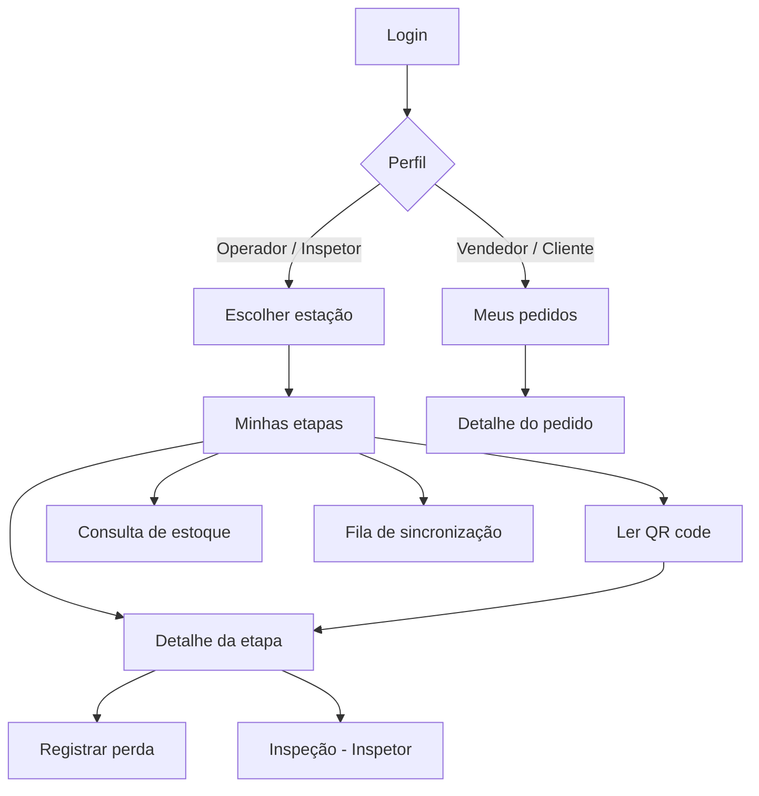

# 08 - Aplicativo Mobile (Etapa 5)

**Disciplina:** Desenvolvimento Mobile
**Projeto:** `mobile/aurora_mobile`
**Tecnologia:** ⚠️ **a definir**: Flutter (Dart), que a turma aprendeu na disciplina, ou React Native.
Aguardando resposta do professor de mobile (ver §1.1).
**Relacionados:** `06-api-rest.md`, `05-banco-de-dados.md` (ApontamentoProducao), `00-escopo.md` §10

> Tudo neste documento, **exceto a tabela da §1.2**, vale para qualquer tecnologia: telas,
> fluxo, regras offline, integração com a API, segurança e acessibilidade. Quando a
> decisão sair, mantenha a coluna escolhida da §1.2 e apague a outra.

---

## 1. Visão geral

Um único aplicativo, com **navegação por perfil** depois do login.

| Perfil | Uso principal |
|---|---|
| Operador | Apontar início/fim de etapa lendo o QR da OP; registrar refugo |
| Inspetor | Iniciar e concluir a etapa de Qualidade com a inspeção |
| Vendedor | Consultar os pedidos que criou |
| Cliente | Acompanhar o andamento do próprio pedido (somente leitura) |

| Item | Definição |
|---|---|
| Padrão de interface | **MVVM** ou equivalente da tecnologia (tela separada da lógica de apresentação) |
| Plataforma | **Android primeiro**; iOS é suportado pelas duas tecnologias, mas compilar para iOS exige um Mac com Xcode |
| Rede | HTTPS para a API; no emulador Android o host da máquina é `10.0.2.2` |
| Configuração por ambiente | URL da API definida em tempo de build (dev, hom, prod) |
| Idioma | Português (pt-BR) |

> A API REST é a mesma para web e mobile (`06-api-rest.md`): trocar a tecnologia do app não
> altera o backend nem o banco.

### 1.1 Decisão da tecnologia

| Opção | A favor | Contra |
|---|---|---|
| **Flutter (Dart)** | É o que o professor ensinou; menor risco na avaliação | O grupo tem menos experiência |
| **React Native (Expo + TypeScript)** | O grupo já domina | Pode não ser aceito pelo professor; exige defender o código na apresentação |

**Ação:** perguntar ao professor de mobile: *"O PIM IV permite fazer o app em React Native em
vez de Flutter?"* Registrar a resposta e a data em `docs/DECISOES.md`. **Se não houver
resposta a tempo, usar Flutter.** Não iniciar a implementação do app antes da decisão.

### 1.2 Equivalência de pacotes por tecnologia

| Necessidade | Flutter (Dart) | React Native (Expo + TypeScript) |
|---|---|---|
| Linguagem | Dart | TypeScript |
| Navegação por rotas protegidas | `go_router` | Expo Router ou React Navigation |
| Estado e MVVM | `provider` (`ChangeNotifier`) | Context + hooks (cada ViewModel é um hook) ou Zustand |
| Cliente HTTP com interceptor | `dio` (`QueuedInterceptor`) | `axios` (interceptors) |
| Armazenamento seguro de tokens | `flutter_secure_storage` | `expo-secure-store` |
| Banco local (SQLite) | `sqflite` | `expo-sqlite` |
| Leitura de QR code | `mobile_scanner` | `expo-camera` (leitura de código de barras/QR) |
| Conectividade | `connectivity_plus` | `@react-native-community/netinfo` |
| Identificadores (UUID) | `uuid` | `expo-crypto` (`randomUUID`) ou `uuid` |
| Sincronização em segundo plano (opcional) | `workmanager` | `expo-background-task` |
| Datas e idioma | `intl` + `flutter_localizations` | `Intl`/`date-fns` + `i18n-js` ou equivalente |
| Testes de unidade e de componente | `flutter_test`, `mocktail` | Jest + React Native Testing Library |
| Teste de fluxo ponta a ponta | `integration_test` | Maestro ou Detox |
| Análise estática | `flutter analyze` | ESLint + `tsc` |
| URL da API por ambiente | `--dart-define=API_BASE_URL=...` | `EXPO_PUBLIC_API_BASE_URL` / `app.config.ts` |
| Build do Android | `flutter build apk --release` | `eas build` ou `expo prebuild` + Gradle |

---

## 2. Telas

| Tela | Perfis | Conteúdo | RF |
|---|---|---|---|
| **Login** | Todos | E-mail, senha, mensagem de erro, "manter conectado" (refresh token) | RF01 |
| **Escolher estação** | Operador, Inspetor | Lista das estações; escolha salva no aparelho | RF11 |
| **Minhas etapas** | Operador, Inspetor | Etapas pendentes e em andamento da estação; selo de **sincronização** (online/offline, itens pendentes) | RF11 |
| **Ler QR code** | Operador, Inspetor | Câmera; ao ler abre a OP e a etapa correspondente à estação | RF11 |
| **Detalhe da etapa** | Operador, Inspetor | Produto, quantidade, materiais a consumir, botões **Iniciar** / **Finalizar** grandes | RF11, RF13 |
| **Registrar perda** | Operador | Tipo (refugo/retrabalho), quantidade, motivo (**exige conexão**) | RF12 |
| **Inspeção** | Inspetor | Aprovar ou reprovar; se reprovar, estação de retrabalho e observação (**exige conexão**) | RF18 |
| **Consulta de estoque** | Operador | Saldo de matérias-primas (último dado conhecido e hora da atualização) | RF14 |
| **Fila de sincronização** | Operador, Inspetor | Itens pendentes, enviados e rejeitados, com motivo | RF23 |
| **Meus pedidos** | Vendedor, Cliente | Lista com status | RF22 |
| **Detalhe do pedido** | Vendedor, Cliente | Itens e **linha do tempo** da produção | RF22 |
| **Configurações** | Todos | Sair, tamanho da fonte, versão do app | - |

---

## 3. Fluxo de navegação



**Fluxo do operador (caso de uso UC05):**
abre o app → escolhe a estação → toca em **Ler QR** → a etapa aparece → **Iniciar** (consome material)
→ trabalha → **Finalizar**. Cada toque gera um apontamento com `clientRequestId`.

---

## 4. Autenticação

- Login em `POST /auth/login`; **access token** e **refresh token** guardados no **armazenamento seguro do sistema** (Keystore no Android, Keychain no iOS), nunca em armazenamento comum.
- Um **interceptor HTTP** anexa o Bearer e, ao receber `401`, tenta **uma** renovação pelo refresh; chamadas simultâneas esperam a mesma renovação; se falhar, volta ao Login.
- **Logout** revoga o refresh token na API e **apaga o banco local**.
- Nunca guardar a senha no aparelho.
- Rotas protegidas: redirecionar para o Login se não houver sessão e esconder telas que o perfil não pode usar (a API continua sendo a barreira real).

---

## 5. Funcionamento offline e sincronização (RF23)

### O que funciona sem rede
| Ação | Offline? |
|---|---|
| Ver etapas já carregadas | Sim (cache local) |
| **Iniciar / Finalizar etapa** | **Sim** (fica na fila) |
| Registrar perda, inspeção, estoque atualizado | Não (exige conexão; o app avisa) |

### Banco local (SQLite)
| Tabela | Colunas principais |
|---|---|
| `etapa_cache` | etapa_id, ordem_producao_id, numero_op, produto_nome, estacao_id, sequencia, status, quantidade, atualizado_em |
| `apontamento_pendente` | **client_request_id (PK)**, tipo (`Inicio`/`Fim`), etapa_id, data_hora_cliente, tentativas, estado (`Pendente`/`Enviando`/`Rejeitado`), mensagem |
| `pedido_cache` | pedido_id, numero, status, prazo, resumo_json, atualizado_em |

### Algoritmo
1. Ao tocar em Iniciar/Finalizar, o app **grava o apontamento na fila** (com um UUID como `clientRequestId`) e atualiza o estado local da etapa (marcado "pendente de envio").
2. O serviço de sincronização envia a fila, em ordem de `data_hora_cliente`, em lotes de até **50** itens para `POST /apontamentos/sincronizar`.
3. **Quando sincroniza:** ao voltar a conexão, ao abrir o app, a cada 5 minutos em primeiro plano e por **puxar para atualizar**. Sincronização em segundo plano é opcional.
4. Resultado por item: `Aplicado` ou `JaProcessado` → remove da fila; `Rejeitado` → permanece com a mensagem para o usuário (ex.: "Etapa anterior não concluída").
5. Ao final, recarrega `etapa_cache` do servidor (o servidor é a **fonte da verdade**).

```mermaid
sequenceDiagram
    participant Op as Operador
    participant App as App (SQLite local)
    participant Api as API
    participant Db as SQL Server
    Op->>App: Toca Iniciar (sem rede)
    App->>App: Grava na fila + estado local
    Note over App: Rede volta
    App->>Api: POST /apontamentos/sincronizar (lote)
    Api->>Db: sp_IniciarEtapa (idempotente por clientRequestId)
    Db-->>Api: OK ou erro 51001/51002
    Api-->>App: resultados por item
    App->>App: Remove aplicados; marca rejeitados
    App->>Api: GET /etapas/minhas (atualiza cache)
```

### Regras e limitações (documentar no texto)
- **Idempotência:** reenviar o mesmo `clientRequestId` nunca duplica baixa de estoque.
- **Conflito:** vence a regra do servidor. Iniciar offline pode ser **rejeitado** na sincronização por falta de saldo (RN04) ou ordem inválida (RN05); o app mostra o motivo e permite descartar.
- **Reconciliação de relógio:** `data_hora_cliente` registra quando o operador agiu; o servidor grava quando processou.
- **Prevenção:** a tela de estoque mostra o último saldo conhecido e a hora em que foi atualizado.

---

## 6. Integração com a API

| Necessidade | Endpoint |
|---|---|
| Login e renovação | `/auth/login`, `/auth/refresh`, `/auth/logout` |
| Etapas da estação | `GET /etapas/minhas?estacaoId=` |
| Localizar OP pelo QR | `GET /ordens-producao/qr/{codigoQr}` |
| Apontar (online) | `POST /etapas/{id}/iniciar`, `POST /etapas/{id}/finalizar` |
| Apontar (lote offline) | `POST /apontamentos/sincronizar` |
| Perda e inspeção | `POST /etapas/{id}/perdas`, `POST /ordens-producao/{id}/inspecoes` |
| Estoque | `GET /estoque/materias-primas` |
| Pedidos | `GET /meus-pedidos` (cliente), `GET /pedidos` (vendedor), `GET /pedidos/{id}/acompanhamento` |

Em condições normais (online), o app chama `iniciar`/`finalizar` direto para resposta imediata;
a fila serve quando a chamada falha por rede. Erros `ProblemDetails` (campo `code`) viram
mensagens em português para o usuário.

---

## 7. Organização do código (independente da tecnologia)

```
mobile/aurora_mobile/
├─ código-fonte        Flutter: lib/   ·   React Native: app/ e src/
│  ├─ core/            cliente HTTP + interceptor, armazenamento seguro de tokens,
│  │                   banco local (SQLite) e migrações, conectividade, configuração, tema
│  ├─ features/        auth · etapas · qr · sync · perdas · inspecao · estoque · pedidos
│  │                   (cada uma com data → domain → presentation)
│  └─ shared/          componentes reutilizáveis (botão grande, selo de sincronização, estados vazios)
├─ testes              unidade, componente/widget e fluxo ponta a ponta
└─ arquivos de projeto pubspec.yaml e analysis_options.yaml (Flutter) · package.json, tsconfig e app.config (React Native)
```

Cada *feature* separa acesso a dados, regras e interface, espelhando a divisão em camadas do backend.

---

## 8. Usabilidade e acessibilidade

- **Operadores com luva ou pressa:** botões grandes (alvo de toque mínimo de **48 dp**), poucas ações por tela, confirmação clara após cada apontamento (vibração e mensagem).
- **Leitor de tela (TalkBack):** descrição e dica em todos os controles (Flutter: `Semantics`; React Native: `accessibilityLabel`, `accessibilityRole`, `accessibilityHint`); ordem de foco lógica; itens decorativos fora da leitura.
- **Fonte:** respeitar a escala de texto do sistema e testar com 200%.
- **Contraste:** mínimo 4,5:1; estados (pendente, rejeitado) com **ícone e texto**, não só cor; tema de alto contraste.
- **Estados vazios e erros:** mensagens em linguagem simples e com a ação seguinte.
- **Indicador permanente** de conexão e de itens pendentes de sincronização.

## 9. Segurança

| Risco | Medida |
|---|---|
| Roubo de token | Armazenamento seguro do sistema; tokens de vida curta; revogação no logout |
| Interceptação | Somente HTTPS; certificados válidos |
| Dados no aparelho | Cache mínimo; banco local apagado no logout |
| Perfil indevido | A API valida o perfil; o app apenas esconde telas |
| Binário | Sem segredos embutidos; URL da API por configuração de build; ofuscação/minificação no build de release |

## 10. Testes e build

- **Unidade:** ViewModels e serviço de sincronização com API e repositórios falsos: aplicado, rejeitado, rede caindo no meio, reenvio do mesmo `clientRequestId`.
- **Componente/widget:** login, lista de etapas, fila de sincronização.
- **Fluxo ponta a ponta:** modo offline → iniciar → finalizar → reconectar → conferir fila.
- **Roteiro manual:** modo avião no emulador; repetir com saldo insuficiente.
- **Acessibilidade:** fluxo do operador com TalkBack ligado.
- **Análise estática** sem avisos e **build** de release do Android (comandos na §1.2).

## 11. Evidências para o texto

Salvar em `docs/evidencias/`: `E05-login.png`, `E05-minhas-etapas.png`, `E05-leitura-qr.png`,
`E05-detalhe-etapa.png`, `E05-fila-sincronizacao.png`, `E05-pedido-cliente.png`, `E05-modo-offline.png`.
