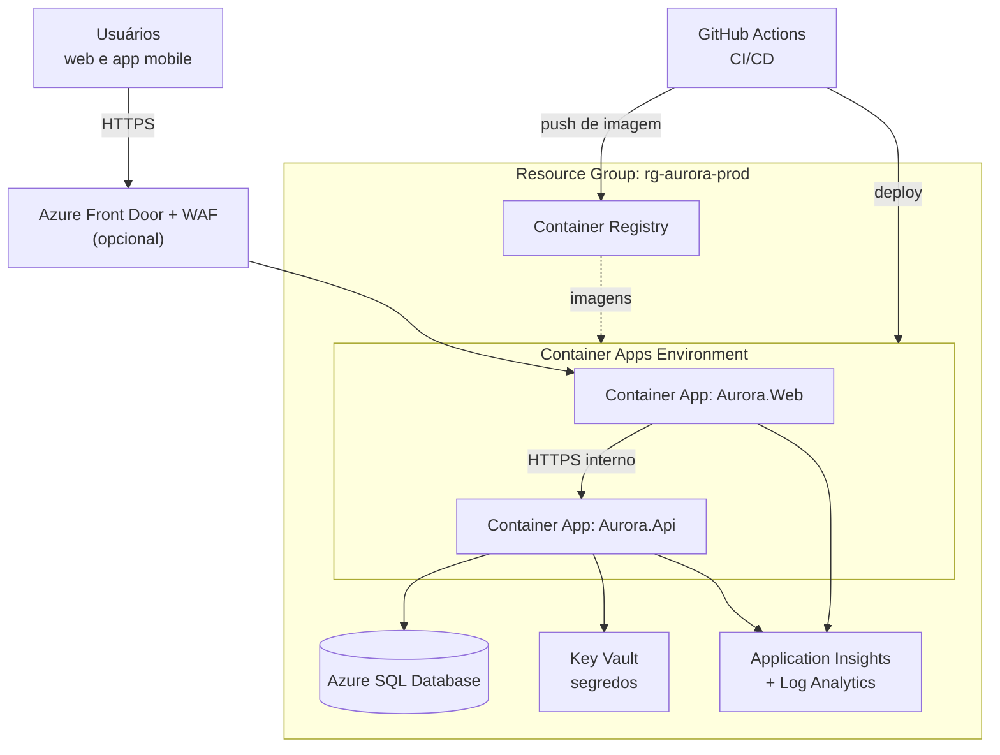

# 09 - Infraestrutura em Nuvem e DevOps (Etapa 8)

**Disciplina:** Cloud Computing e DevOps
**Provedor:** ⚠️ Azure (a confirmar com o professor; os conceitos valem para AWS e GCP)
**Relacionados:** `04-arquitetura.md`, `05-banco-de-dados.md`, `06-api-rest.md`

---

## 1. Arquitetura em nuvem

### Serviços utilizados

| Serviço | Papel | Observações |
|---|---|---|
| **Azure Container Apps** (ou App Service for Containers) | Executa `Aurora.Api` e `Aurora.Web` em containers | Escala automática; revisões com troca sem parada |
| **Azure SQL Database** | Banco gerenciado | TDE ativo, backups automáticos, PITR |
| **Azure Container Registry (ACR)** | Guarda as imagens Docker | Imagem marcada com o hash do commit |
| **Azure Key Vault** | Segredos (connection string, chave JWT) | Acesso por **Managed Identity**, sem senha no código |
| **Application Insights + Log Analytics** | Logs, métricas, rastreamento, alertas | Consulta em KQL |
| **Azure Front Door + WAF** (opcional) | Entrada global, TLS, proteção de borda | Entra se sobrar escopo |
| **GitHub Actions** | CI/CD | Autenticação por **OIDC** (sem segredo de longa duração) |
| **Bicep** | Infraestrutura como código | Pasta `infra/` |

### Ambientes

| Ambiente | Uso | Banco | Observação |
|---|---|---|---|
| **dev** | Desenvolvimento local | SQL Server em container | `docker compose up` |
| **hom** (homologação) | Testes e demonstração ao professor | Azure SQL (camada baixa) | Deploy automático da `main` |
| **prod** | Operação | Azure SQL | Deploy com **aprovação manual** |

---

## 2. Containers

### Dockerfiles (`docker/`)
- **Multi-stage** para API e Web: estágio `sdk` compila e publica; estágio `aspnet` (imagem mínima) só executa.
- Executar como **usuário não-root**; porta 8080; sem segredos na imagem.
- `HEALTHCHECK` apontando para `/health`.
- `.dockerignore` para não copiar `bin`, `obj`, `.git`.

### `docker-compose.yml` (ambiente local)
| Serviço | Imagem | Função |
|---|---|---|
| `sql` | SQL Server (Linux) | Banco local; volume persistente |
| `dbup` | Imagem do runner de scripts | Aplica `database/*.sql` na subida |
| `api` | Build de `Aurora.Api` | Depende de `sql` saudável |
| `web` | Build de `Aurora.Web` | Aponta para `api` |

Variáveis em `.env` (não versionado): `SA_PASSWORD`, `ConnectionStrings__Aurora`, `Jwt__Key`, `Api__BaseUrl`.

---

## 3. Pipeline CI/CD (GitHub Actions)

### Fluxo de ramificação
GitHub Flow: ramos curtos `feat/...`, **pull request** com revisão obrigatória de outro
integrante e CI verde; merge na `main` dispara hom; tag `v*` ou aprovação dispara prod.

### CI (`.github/workflows/ci.yml`) - a cada push e pull request
| Etapa | O que faz |
|---|---|
| 1. Restore e build | `dotnet restore` e `dotnet build -warnaserror` |
| 2. Testes | `dotnet test` com cobertura (meta ≥ 70%), incluindo integração com SQL Server em container |
| 3. Qualidade e segurança | `dotnet list package --vulnerable`; análise estática (CodeQL); varredura de segredos |
| 4. Imagens | Build das imagens Docker da API e da Web |
| 5. Varredura de imagem | Trivy nas imagens |
| 6. Publicação | Push no ACR (apenas na `main`/tags), marcado com o SHA do commit |

### CD (`.github/workflows/deploy.yml`)
| Etapa | O que faz |
|---|---|
| 1. Login | Azure via OIDC |
| 2. Banco | Executa o **DbUp** contra o ambiente (scripts numerados, já aplicados são ignorados) |
| 3. Deploy | Atualiza os Container Apps com a imagem do SHA |
| 4. Verificação | *Smoke test*: `GET /health/ready` deve responder 200 |
| 5. Promoção | Hom → Prod com **aprovação manual** (GitHub Environments) |
| 6. Reversão | Se o smoke test falhar, volta para a revisão anterior |

### Mobile
Workflow `mobile.yml`, criado **depois da escolha da tecnologia** (comandos na tabela da
`08-mobile.md` §1.2): instalar dependências, análise estática, testes e build de release
gerando o **APK/AAB** assinado (Java e a SDK da tecnologia escolhida no runner);
distribuição interna por arquivo. Chaves de assinatura e URL por ambiente em GitHub
Secrets/Variables.

---

## 4. Monitoramento

| Camada | Ferramenta | O que acompanhar |
|---|---|---|
| Aplicação | Application Insights | Requisições por rota, **tempo de resposta (p95)**, taxa de falha, exceções, dependências (SQL) |
| Logs | Serilog estruturado → Log Analytics | `traceId` em cada requisição; níveis; **sem** dados pessoais ou tokens |
| Saúde | `/health` e `/health/ready` | Disponibilidade da API e do banco |
| Banco | Métricas do Azure SQL e Query Store | CPU, DTU/vCore, consultas lentas, deadlocks |
| Negócio | Painel do sistema | OPs paradas, estoque crítico |

### Alertas (Azure Monitor)
| Alerta | Condição | Ação |
|---|---|---|
| API indisponível | `/health` falha por 3 min | Notificar o grupo |
| Latência alta | p95 > 2 s por 10 min | Notificar |
| Erros 5xx | > 2% em 5 min | Notificar |
| Banco sobrecarregado | CPU > 80% por 10 min | Notificar e avaliar escala |
| Segredo prestes a expirar | 30 dias | Lembrete |

Painel (workbook) com: requisições/min, p95, erros, instâncias ativas, CPU do banco.

---

## 5. Escalabilidade e disponibilidade

| Estratégia | Aplicação |
|---|---|
| **API sem estado** | Sem sessão em memória; token JWT; permite várias instâncias |
| **Escala horizontal automática** | Regra por requisições concorrentes ou CPU > 70%; mínimo 2 instâncias em prod, máximo 6 |
| **Escala do banco** | Aumentar vCore/DTU; leitura de relatórios em réplica (evolução) |
| **Cache** | Consultas de apoio (estações, perfis) em cache de memória curto; Redis como evolução |
| **Resiliência** | Retentativas com Polly (backoff) nas chamadas web→API e app→API |
| **Disponibilidade** | Meta 99% no horário de operação; revisões com troca sem parada; *health probes* |
| **Backup e recuperação** | PITR do Azure SQL; **RPO 15 min, RTO 4 h**; testar a restauração uma vez |
| **Custo** | Camadas mínimas em hom; *scale to zero* possível fora do horário em hom |

---

## 6. Segurança da infraestrutura

| Área | Medida |
|---|---|
| Identidade | **Managed Identity** da aplicação acessa Key Vault e SQL; sem senhas no código |
| Segredos | Key Vault; rotação; nada em repositório (varredura de segredos no CI) |
| Rede | HTTPS obrigatório; TLS 1.2+; firewall do SQL só para o ambiente da aplicação (ideal: *private endpoint*) |
| Acesso humano | Princípio do menor privilégio (RBAC do Azure); MFA para contas do grupo |
| Imagens | Base mínima, usuário não-root, varredura Trivy, atualização periódica |
| Dependências | Verificação de vulnerabilidades no CI; Dependabot |
| Proteção de borda | WAF no Front Door (opcional); limite de requisições no login |
| Dados | TDE; `Encrypt=True`; mascaramento para usuário de relatórios; LGPD |
| Auditoria | Auditoria do Azure SQL e logs de atividade do Azure |
| Cadeia de suprimentos | Ações do GitHub fixadas por versão; OIDC em vez de chaves |

---

## 7. Infraestrutura como código (`infra/`)

| Arquivo | Cria |
|---|---|
| `main.bicep` | Orquestra os módulos por ambiente |
| `modules/acr.bicep` | Container Registry |
| `modules/sql.bicep` | Servidor e banco Azure SQL, regras de firewall, auditoria |
| `modules/containerapps.bicep` | Ambiente, API e Web com identidade gerenciada e escala |
| `modules/keyvault.bicep` | Key Vault e políticas de acesso |
| `modules/monitor.bicep` | Log Analytics, App Insights e alertas |
| `parameters.hom.json` / `parameters.prod.json` | Valores por ambiente |

Comando de referência: `az deployment group create -g rg-aurora-<env> -f infra/main.bicep -p infra/parameters.<env>.json`.

---

## 8. Variáveis de configuração

| Variável | Onde fica | Exemplo |
|---|---|---|
| `ConnectionStrings__Aurora` | Key Vault (referência no Container App) | `Server=...;Database=aurora;Encrypt=True;...` |
| `Jwt__Key` | Key Vault | segredo aleatório de 256 bits |
| `Jwt__Issuer`, `Jwt__Audience` | Configuração do app | `aurora-api` |
| `Api__BaseUrl` | Configuração da Web | `https://api-hom.aurora...` |
| `ASPNETCORE_ENVIRONMENT` | Container App | `Production` |
| `SEED_ADMIN_PASSWORD` | Somente dev/hom, fora do repositório | - |

---

## 9. Evidências para o texto da Etapa 8

Salvar em `docs/evidencias/`:
`E08-arquitetura-nuvem.png` (diagrama da §1), `E08-pipeline-ci.png`, `E08-pipeline-cd.png`,
`E08-container-apps.png`, `E08-app-insights.png`, `E08-alerta.png`, `E08-docker-compose.png`.
> Se não houver assinatura Azure, usar as telas do `docker compose` e do CI no GitHub como
> evidência e descrever a arquitetura de nuvem como **projeto** (a etapa pede "definir").
