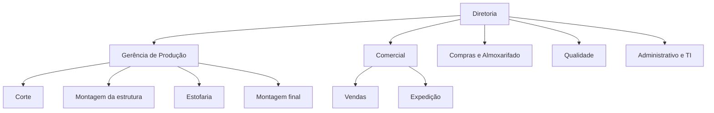
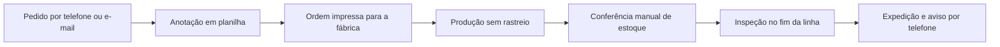
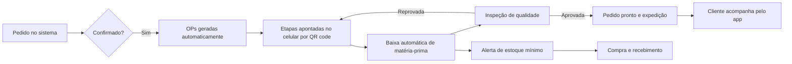

# 11 - Negócio, Viabilidade e Responsabilidade Social (Etapas 1, 2 e 3)

**Disciplinas:** Empreendedorismo em TI (Etapa 2) · Relações Étnico-Raciais e Ensino de Culturas Afro-Indígenas (Etapa 3)
**Relacionados:** `00-escopo.md`, `02-backlog-agil.md`, `05-banco-de-dados.md`

> **Aviso importante:** os números deste documento são **premissas fictícias** para o
> exercício. Não há dados de mercado reais aqui. Troquem pelos valores do grupo e **pesquisem
> e citem em ABNT** as fontes reais (§6). O professor avalia o raciocínio e a coerência.
> Os textos são base de trabalho: reescrevam com as próprias palavras.

---

## 1. Etapa 1: Caracterização da organização

### 1.1 Ficha da empresa (fictícia)

| Item | Premissa |
|---|---|
| Nome | **Aurora Cadeiras Indústria Moveleira Ltda** (sugestão; trocar se quiserem) |
| Segmento | Indústria moveleira: fabricação de cadeiras (conferir a CNAE no IBGE/CONCLA; por exemplo 3101-2/00, móveis com predominância de madeira, e 3102-1/00, com predominância de metal) |
| Porte | Média empresa, cerca de **80 colaboradores** em 2 turnos (premissa) |
| Mercado | Vendas B2B: lojas de móveis, escritórios, restaurantes e hotelaria |
| Produtos | Três linhas e seis modelos: Escritório (CE-100, CE-200), Jantar (CJ-100, CJ-200), Estofada (CS-100, CS-200) |
| Serviços | Personalização de tecido e acabamento sob encomenda |
| Situação de TI | Planilhas e papel; sem rastreio da produção; sem controle automático de estoque |

### 1.2 Estrutura organizacional

### 1.3 Principais processos

**Como é hoje (AS-IS):**

**Como será com o sistema (TO-BE):**

### 1.4 Problemas e oportunidades

| Problema identificado | Impacto | Oportunidade com tecnologia | Onde a solução atua |
|---|---|---|---|
| Pedidos e estoque em planilhas | Erros e retrabalho de digitação | Cadastro único e integrado | Módulos Pedidos e Estoque (RF07, RF14) |
| Sem rastreio por etapa | Ninguém sabe onde está cada pedido | Apontamento por QR code em tempo real | App do operador (RF11), painel (RF20) |
| Falta ou excesso de matéria-prima | Paradas na produção e capital parado | Baixa automática e alerta de mínimo | RF13, RF15 |
| Defeito descoberto só no fim | Retrabalho caro | Inspeção como etapa rastreada com retorno à estação | RF18, RN06 |
| Relatórios feitos à mão | Decisão lenta e sem dados | Painel e relatórios exportáveis | RF20, RF21 |
| Cliente liga para saber o status | Carga no atendimento | Acompanhamento no app | RF22 |

---

## 2. Etapa 2: Planejamento da solução tecnológica

### 2.1 Problema, objetivos e público-alvo

- **Problema:** falta de visibilidade e de controle integrado de pedidos, produção e estoque.
- **Objetivo geral:** automatizar o fluxo pedido → produção → estoque → expedição, com rastreio em tempo real.
- **Objetivos específicos (mensuráveis, metas são premissas):**
  - reduzir a perda de matéria-prima de 6% para 4% em 6 meses;
  - reduzir o tempo gasto em controles manuais em 70%;
  - ter 100% das ordens de produção rastreadas por etapa;
  - responder o status de qualquer pedido em menos de 1 minuto.
- **Público-alvo:** usuários internos (gerência, produção, qualidade, compras, vendas) e clientes B2B que acompanham pedidos.

### 2.2 Proposta de valor, benefícios e diferenciais

- **Proposta de valor:** reduzir desperdício e prazo de entrega com controle em tempo real.
- **Benefícios esperados:** menos retrabalho e perdas, estoque sob controle, decisões com dados, atendimento ao cliente mais rápido.
- **Diferenciais competitivos:** apontamento por QR code no celular, funcionamento **offline** no chão de fábrica, ficha técnica que liga pedido, produção e estoque, painel gerencial em tempo real.

### 2.3 Modelo de negócio (Canvas da Aurora Cadeiras)

| Bloco | Conteúdo |
|---|---|
| **Segmentos de clientes** | Lojas de móveis, empresas e escritórios, restaurantes e hotelaria (B2B) |
| **Proposta de valor** | Cadeiras duráveis e personalizáveis, prazo previsível, linha com identidade cultural brasileira |
| **Canais** | Equipe de vendas, representantes, feiras; (loja virtual como evolução) |
| **Relacionamento** | Acompanhamento do pedido pelo app, pós-venda dedicado |
| **Fontes de receita** | Venda de cadeiras por pedido; personalização sob encomenda |
| **Recursos principais** | Maquinário, equipe qualificada, sistema Aurora, matérias-primas |
| **Atividades-chave** | Produzir, comprar, controlar qualidade, vender, expedir |
| **Parcerias principais** | Fornecedores (incluindo comunidades tradicionais), transportadoras, designers |
| **Estrutura de custos** | Matéria-prima, mão de obra, energia, logística, TI |

### 2.4 Análise SWOT

| | Positivo | Negativo |
|---|---|---|
| **Interno** | **Forças:** linha diversificada; processo organizado em estações; apoio da direção à digitalização | **Fraquezas:** controle manual; sem rastreio; equipe com pouca experiência digital |
| **Externo** | **Oportunidades:** transformação digital; demanda por móveis de escritório; valorização do design brasileiro; rastreabilidade da madeira de origem legal | **Ameaças:** concorrência de produtos importados; variação de preço de matéria-prima; exigências ambientais |

### 2.5 Estudo de viabilidade

| Tipo | Análise |
|---|---|
| **Técnica** | Tecnologias consolidadas (.NET, SQL Server, mobile multiplataforma), documentadas e com comunidade ativa; arquitetura modular; equipe de 4 integrantes |
| **Operacional** | Treinamento dos operadores; **piloto por estação** antes do uso geral; interface simples e acessível para reduzir resistência |
| **Legal** | Conformidade com a **LGPD** (dados de clientes e usuários); licenças de software e de nuvem; registro de acesso |
| **Prazo** | 6 sprints de 2 semanas (ver `02-backlog-agil.md`) |
| **Econômica** | Cálculo abaixo |

#### Cálculo econômico (premissas fictícias, ajustar)

**Investimento inicial (desenvolvimento):**
4 desenvolvedores × 12 semanas × 20 h/semana = **960 h**; a R$ 80/h = **R$ 76.800**.

**Custos recorrentes mensais:**
| Item | Valor mensal (premissa) |
|---|---|
| Infraestrutura em nuvem (estimar na calculadora de preços do provedor e anexar o print) | R$ 1.500 |
| Manutenção e suporte | R$ 1.000 |
| **Total recorrente** | **R$ 2.500** |

**Ganhos mensais:**
| Item | Cálculo | Valor mensal |
|---|---|---|
| Menos perda de matéria-prima | 2 pontos percentuais sobre R$ 400.000 de gasto mensal em material | R$ 8.000 |
| Menos horas em controles manuais | 120 h/mês × R$ 35/h | R$ 4.200 |
| **Total de ganhos** | | **R$ 12.200** |

**Resultado:**
- Ganho líquido mensal = 12.200 − 2.500 = **R$ 9.700**
- **Payback** = 76.800 ÷ 9.700 ≈ **7,9 meses**
- **ROI em 12 meses** = (9.700 × 12 − 76.800) ÷ 76.800 ≈ **52%**

> Mostrar na apresentação **de onde vêm** os números (premissas) e **o que mudaria** o
> resultado (análise de sensibilidade: e se o ganho for metade?). Com ganho de R$ 6.100 e custo
> recorrente de R$ 2.500, o líquido cai para R$ 3.600 e o payback sobe para
> 76.800 ÷ 3.600 ≈ **21 meses**.

---

## 3. Etapa 3: Responsabilidade social e diversidade

Cada item do manual vira uma **ação concreta**, ligada a algo que o sistema faz ou mede.

| Item do manual | Ação da Aurora | Como a solução apoia | Indicador |
|---|---|---|---|
| **Combate à discriminação** | Política antidiscriminatória, treinamento de lideranças, seleção sem discriminação de raça, cor, origem, gênero ou deficiência, e canal interno de denúncias (processo organizacional, previsto como evolução do sistema) | Perfis de acesso por função, sem dados de raça ou religião no cadastro; auditoria de ações (RNF10) | Horas de treinamento por ano; denúncias tratadas no prazo |
| **Valorização da diversidade** | Linha de produtos inspirada em grafismos e técnicas **afro-brasileiras e indígenas**, **em parceria remunerada** com artesãos e comunidades, com créditos e consulta prévia | Fornecedor com marcador **"comunidade tradicional"** (campo `ComunidadeTradicional`); matéria-prima como palha natural; relatório **compras-comunitarias** | % de compras de fornecedores de comunidades tradicionais |
| **Recursos tecnológicos inclusivos** | Interface simples, ícones e pictogramas, linguagem direta, botões grandes para uso com luvas, tema de alto contraste, fonte ajustável | Telas web e mobile com requisitos da seção de acessibilidade (RNF07, RNF08); evolução: instruções em vídeo com Libras | Nota Lighthouse ≥ 90; testes com TalkBack |
| **Ações de acessibilidade** | Adotar **WCAG 2.1 nível AA**; avaliação com usuários com deficiência; adequação dos postos de trabalho | Contraste, navegação por teclado, leitor de tela, ampliação de texto a 200% | % de telas aprovadas na auditoria de acessibilidade |
| **Tecnologia para a cidadania** | Capacitação digital dos colaboradores, vagas de jovem aprendiz, transparência para o cliente (acompanhamento do pedido), proteção de dados pessoais | App de acompanhamento (RF22); tratamento de dados conforme a LGPD (RNF11); treinamento no próprio sistema | Colaboradores capacitados; % de pedidos acompanhados pelo app |

### Cuidados no texto (disciplina de Relações Étnico-Raciais)

- Tratar **parceria, remuneração justa, crédito e consulta às comunidades** como condição, e não como uso de cultura "de fachada". Evitar estereótipos e a apropriação cultural.
- Falar de **pessoas** (artesãos, comunidades, colaboradores), e não só de "produto" ou "estética".
- Mostrar que a medida é **verificável**: indicadores e relatório no sistema, e não só intenção.
- Relacionar com o conteúdo da disciplina: história e culturas afro-brasileira e indígena, racismo estrutural, inclusão no trabalho.

### Base legal e normativa para citar (conferir o texto atualizado e citar em ABNT)

- Constituição Federal de 1988, em especial o art. 5º (inciso XLII: o racismo é crime).
- Lei nº 7.716/1989 (crimes resultantes de preconceito de raça ou de cor).
- Leis nº 10.639/2003 e nº 11.645/2008 (ensino de história e cultura afro-brasileira e indígena).
- Lei nº 12.288/2010 (Estatuto da Igualdade Racial).
- Convenção nº 169 da OIT (povos indígenas e tribais).
- Lei nº 13.146/2015 (Lei Brasileira de Inclusão da Pessoa com Deficiência).
- Lei nº 8.213/1991, art. 93 (reserva de vagas para pessoas com deficiência em empresas com 100 ou mais empregados; a Aurora, com cerca de 80, adota a prática **voluntariamente**).
- Lei nº 10.097/2000 (aprendizagem profissional).
- Lei nº 13.709/2018 (LGPD).
- **WCAG 2.1** (W3C) para acessibilidade digital.

---

## 4. O que deve aparecer no texto do PIM

| Etapa | Itens obrigatórios do manual | Onde buscar aqui |
|---|---|---|
| 1 | Segmento, produtos/serviços, estrutura organizacional, processos, problemas, oportunidades | §1.1 a §1.4 |
| 2 | Problema, objetivos, público-alvo, proposta de valor, benefícios, diferenciais; modelo de negócio e viabilidade | §2.1 a §2.5 |
| 3 | Combate à discriminação, diversidade, recursos inclusivos, acessibilidade, cidadania | §3 |

## 5. Evidências a produzir

Renderizar e salvar em `docs/evidencias/`: `E01-organograma.png`, `E01-processo-asis.png`,
`E01-processo-tobe.png`, `E02-canvas.png` (tabela da §2.3 em imagem), `E02-viabilidade.png`
(planilha com o cálculo da §2.5), `E03-relatorio-compras-comunitarias.png` (depois da implementação).

## 6. Fontes reais a pesquisar e citar (sem inventar números)

- Dados do setor moveleiro: IBGE (pesquisas industriais), associações do setor (Abimóvel, IEMI), SEBRAE.
- Metodologia do Canvas: Osterwalder e Pigneur, *Business Model Generation*.
- Viabilidade e indicadores financeiros: livros de administração financeira da biblioteca da UNIP.
- Custo de TI: tabelas salariais e de horas de mercado; calculadora de preços do provedor de nuvem.
- Autores de metodologia citados no manual (Severino, Lakatos e Marconi, Gil, Cervo e Bervian, Demo) para a Introdução.
