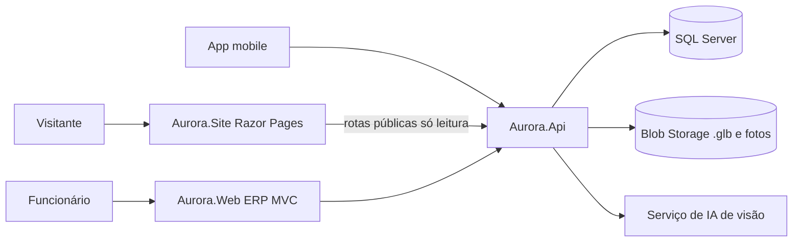

# 12 - Inovação: site público, 3D/AR e orçamento por foto (IA)

Extensão **opcional** do projeto. Entra depois das histórias *Must* (ver `02-backlog-agil.md`). Se o prazo apertar, o núcleo (ERP + API + mobile) continua completo sem este documento.

## 1. Decisões

| # | Decisão | Motivo |
|---|---|---|
| I01 | Dois front-ends: **Aurora.Site** (público) e **Aurora.Web** (ERP interno) | Públicos e riscos diferentes. O site é aberto; o ERP exige login |
| I02 | Site público em **ASP.NET Core Razor Pages**, projeto separado | Continua na disciplina de Web com .NET e é fácil de publicar |
| I03 | Visualizador 3D/AR no **site** com `<model-viewer>` (arquivos `.glb`) | AR no navegador do celular, sem programar AR nativo |
| I04 | AR nativo no app mobile: **fora do escopo** (evolução futura) | Custo alto; o AR no site já cobre a ideia |
| I05 | IA só **lê a foto** e sugere o modelo do catálogo. O preço sai da ficha técnica | Resultado confiável e fácil de defender |
| I06 | Chave da IA só no backend (Key Vault), com limite de uso e aviso LGPD | Segurança e controle de custo |
| I07 | Orçamento por foto só para **Vendedor** (ERP e app), não é público | Evita abuso e custo |

## 2. Arquitetura

Estrutura nova na solução: `src/Aurora.Site`. As camadas Domain, Application e Infrastructure são reaproveitadas.

## 3. Aurora.Site (landing page + catálogo)

| Página | Conteúdo |
|---|---|
| Início | Apresentação da empresa, destaques, chamada para o catálogo |
| Catálogo | Lista de produtos publicados, filtro por linha |
| Detalhe do produto | Fotos, dimensões, materiais, botão **Ver em 3D** e **Ver no meu ambiente (AR)** |
| Sobre | História, valores, responsabilidade social e compras de comunidades tradicionais (Etapa 3) |
| Contato / Orçamento | Formulário que cria uma `SolicitacaoContato` |

Requisitos: acessível (WCAG 2.1 AA), responsivo, sem login, sem dados internos (custo, estoque, fornecedores).

### 3.1 Visualizador 3D/AR

- Componente `<model-viewer>` com `src` = `.glb`, `ar`, `camera-controls` e `alt`.
- No celular, o botão de AR abre a câmera (Scene Viewer no Android, Quick Look no iOS). Se o aparelho não suportar, mostra só o 3D.
- Modelos `.glb` leves (meta: até 5 MB cada), guardados no Blob Storage e servidos por CDN.
- Origem dos modelos: feitos pelo grupo ou com licença livre. Não copiar arquivos ou design de terceiros.

## 4. Orçamento por foto (IA)

Fluxo:

1. O Vendedor envia uma foto da cadeira (ideal: com uma folha A4 ao lado como referência de escala).
2. A API valida o arquivo (tipo, tamanho máximo 5 MB), guarda a foto e chama o serviço de IA de visão.
3. A IA devolve características (tipo, material, estofada ou não, estilo) e dimensões **estimadas**.
4. O sistema sugere os 3 produtos mais parecidos do catálogo e monta uma **estimativa** de consumo e custo a partir da **ficha técnica** (BOM) e do custo das matérias-primas.
5. O Vendedor revisa e confirma. O resultado é salvo como estimativa, não como pedido.

Regras:

| Regra | Descrição |
|---|---|
| RN09 | Dimensões vindas de foto são **estimativa** e aparecem sempre com esse aviso |
| RN10 | O valor do orçamento nunca vem da IA, só da ficha técnica e dos custos cadastrados |
| RN11 | Máximo de 20 análises por usuário por dia (configurável) |
| RN12 | Fotos são apagadas após 30 dias e não são usadas para treinar modelos |

## 5. Banco de dados (acréscimos)

Alterações em `Produto`: `ModeloGlbUrl` (NVARCHAR 500 NULL), `PublicoNoCatalogo` (BIT, padrão 0), `DescricaoPublica` (NVARCHAR 1000 NULL).

| Tabela nova | Campos principais |
|---|---|
| `SolicitacaoContato` | Id, Nome, Email, Telefone, Mensagem, ProdutoId (NULL), Status, CriadoEm |
| `EstimativaFoto` | Id, UsuarioId, FotoUrl, ResultadoIaJson, ProdutoSugeridoId, LarguraCm, AlturaCm, ProfundidadeCm, CustoEstimado, CriadoEm |

Total passa de 25 para **27 tabelas**. Atualizar o DER em `05-banco-de-dados.md` quando a extensão for aprovada.

## 6. API (acréscimos)

| Método | Rota | Acesso |
|---|---|---|
| GET | `/publico/produtos` | Anônimo, só produtos com `PublicoNoCatalogo = 1` |
| GET | `/publico/produtos/{id}` | Anônimo (sem custo nem estoque) |
| POST | `/publico/contatos` | Anônimo, com limite de requisições (rate limit) e captcha |
| GET | `/solicitacoes-contato` | Vendedor, Administrador |
| PATCH | `/solicitacoes-contato/{id}/status` | Vendedor, Administrador |
| POST | `/estimativas-foto` | Vendedor |
| GET | `/estimativas-foto/{id}` | Vendedor (dono) e Administrador |

As rotas `/publico/*` usam DTOs próprios, separados dos DTOs internos, para não vazar campos.

## 7. Backlog (acréscimos)

| ID | História | Prioridade | Pontos |
|---|---|---|---|
| US28 | Como visitante, quero ver o catálogo e a apresentação da empresa no site | Should | 5 |
| US29 | Como visitante, quero enviar uma solicitação de contato ou orçamento | Should | 3 |
| US30 | Como visitante, quero ver a cadeira em 3D e no meu ambiente (AR) | Should | 5 |
| US31 | Como vendedor, quero tratar as solicitações de contato recebidas | Could | 3 |
| US32 | Como vendedor, quero enviar uma foto e receber uma estimativa de produto e custo | Could | 8 |

Total da extensão: **24 pontos**. Sugestão: US28 a US30 no Sprint 5 ou 6 se o MVP *Must* estiver estável; US31 e US32 só se sobrar tempo.

## 8. Segurança, LGPD e custos

- Rate limit e captcha no formulário público. Dados do formulário só para atendimento.
- Aviso de privacidade no site e no envio de foto. Não enviar fotos com pessoas.
- Chave do serviço de IA no Key Vault, nunca no app ou no front.
- Alerta de custo no Azure e limite diário de chamadas (RN11).
- Site e ERP em domínios/subdomínios diferentes (`www` e `erp`), cada um com seu Container App.

## 9. Riscos

| Risco | Mitigação |
|---|---|
| Falta de modelos 3D | Começar com 2 ou 3 produtos de destaque |
| Estimativa imprecisa | RN09, referência A4 e revisão humana |
| Escopo maior que o prazo | Itens *Should/Could*, cortáveis sem afetar o núcleo |
| Custo da IA | Limite por usuário e alerta de custo |

## 10. Prompts para o Claude Code (depois do MVP)

1. **Site:** "Crie o projeto `src/Aurora.Site` (Razor Pages, .NET) consumindo as rotas `/publico/*` da API por HttpClient tipado. Páginas: Início, Catálogo, Detalhe, Sobre, Contato. Siga o `CLAUDE.md` e o `12-inovacao-ia-3d-ar.md`."
2. **3D/AR:** "Na página de detalhe, adicione `<model-viewer>` com AR usando `ModeloGlbUrl`. Esconda os botões se o produto não tiver modelo."
3. **Orçamento por foto:** "Implemente `POST /estimativas-foto` com interface `IServicoVisao` (implementação trocável), validação do arquivo, regras RN09 a RN12 e testes com um serviço de visão falso."

## 11. Evidências para o PIM

Prints do site (início, catálogo, detalhe com 3D e AR no celular), do formulário de contato, da tela de estimativa por foto, e o diagrama da seção 2.
